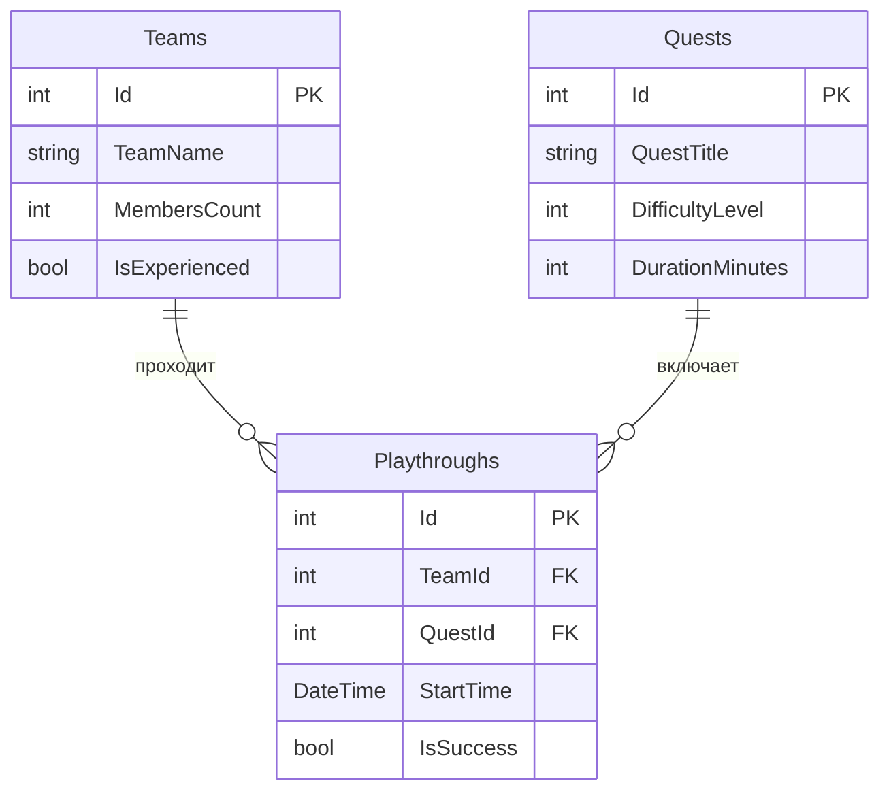

# Побег от химии в наше время

Приложение для бронирования квестов, где команды соревнуются в разгадывании химических загадок.

## Автор

Косенко Андрей, группа РПО-24/2

## О проекте

Тема: Квест-комнаты. 
Название заведения: Квест-рум «Побег от химии в наше время».

Легенда: Вы оказываетесь в секретной лаборатории, где произошла утечка опасного вещества. Чтобы спастись, вашей команде нужно за 60 минут разгадать серию химических головоломок, найти антидот и открыть дверь. Приложение позволяет клиентам выбирать квесты разного уровня сложности и бронировать время, а администраторам — управлять расписанием команд и следить за прохождениями.

В отличие от стандартных квестов, наша локация предлагает научный подход: каждая головоломка — это мини-эксперимент. Игрокам предстоит работать с химической посудой, решать уравнения реакций и определять вещества по их свойствам. Это квест для тех, кто хочет не просто разгадать шифр, а почувствовать себя в роли настоящего ученого.

## Схема базы

## Таблицы

### Таблица Teams (Команды)
Хранит информацию о командах, которые приходят на квест.

| Поле | Тип | Обязательное | Описание |
| :--- | :--- | :--- | :--- |
| Id | int | Да | Первичный ключ, уникальный номер команды |
| TeamName | string | Да | Название команды (например, "Химики-любители") |
| MembersCount | int | Да | Количество человек в команде |
| IsExperienced | bool | Нет | Флаг: проходила ли команда квесты раньше (по умолчанию false) |

### Таблица Quests (Квесты)
Хранит информацию о доступных квестах в заведении, включая их «химическую» особенность.

| Поле | Тип | Обязательное | Описание |
| :--- | :--- | :--- | :--- |
| Id | int | Да | Первичный ключ, уникальный номер квеста |
| QuestTitle | string | Да | Название квеста |
| DifficultyLevel | int | Да | Уровень сложности (от 1 до 5) |
| DurationMinutes | int | Да | Длительность квеста в минутах |
| ReagentsCount | int | Да | Количество химических реактивов, используемых в квесте (наша фишка) |

### Таблица Playthroughs (Прохождения)
Связующая таблица. Хранит записи о том, какая команда какой квест проходила и с каким результатом.

| Поле | Тип | Обязательное | Описание |
| :--- | :--- | :--- | :--- |
| Id | int | Да | Первичный ключ |
| TeamId | int | Да | Внешний ключ на таблицу Teams |
| QuestId | int | Да | Внешний ключ на таблицу Quests |
| StartTime | DateTime | Да | Дата и время начала прохождения |
| IsSuccess | bool | Да | Флаг: успешно ли команда прошла квест (сдала антидот) |

## Связи

Таблицы `Teams` и `Quests` связаны отношением «многие ко многим» через связующую таблицу `Playthroughs`. 

* Одна команда (`Teams`) может проходить много разных квестов (`Quests`). 
* Один и тот же квест (`Quests`) могут проходить разные команды (`Teams`).

В таблице `Playthroughs` за это отвечают два внешних ключа: `TeamId` (ссылается на `Teams.Id`) и `QuestId` (ссылается на `Quests.Id`). Оба ключа обязательные. Свои поля `StartTime` и `IsSuccess` показывают, когда было прохождение и чем оно закончилось.
