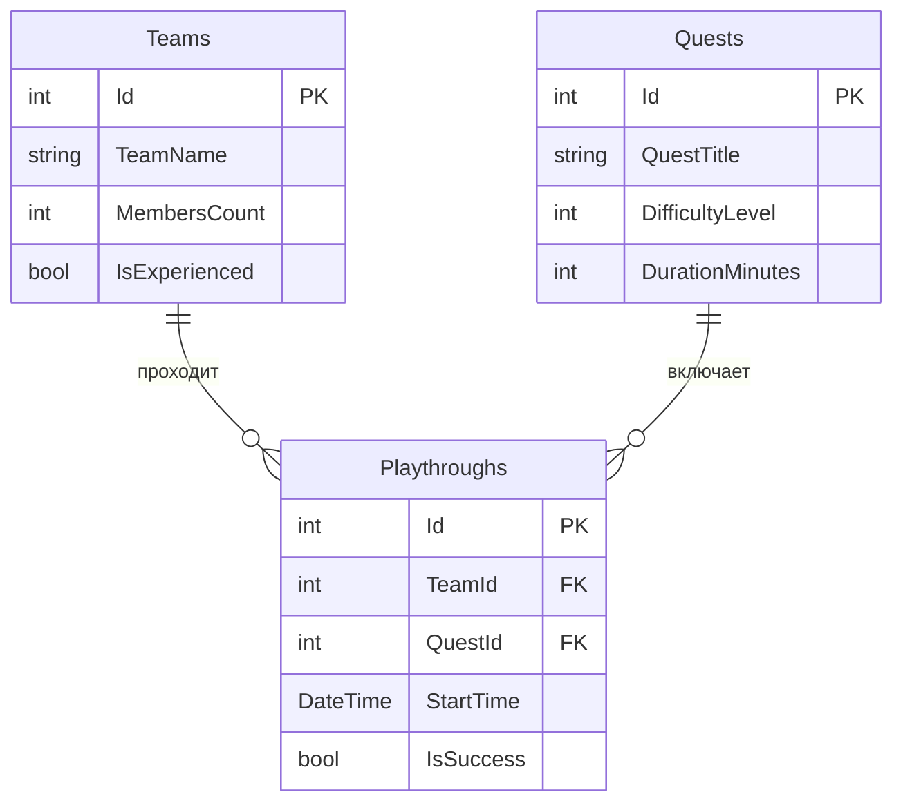

# Побег от химии в наше время

Приложение для бронирования квестов, где команды соревнуются в разгадывании химических загадок.

## Автор

Косенко Андрей, группа РПО-24/2

## О проекте

Тема: Квест-комнаты. 
Название заведения: Квест-рум «Побег от химии в наше время».
Легенда: Вы оказываетесь в секретной лаборатории, где произошла утечка опасного вещества. Чтобы спастись, вашей команде нужно за 60 минут разгадать серию химических головоломок, найти антидот и открыть дверь. Приложение позволяет клиентам выбирать квесты разного уровня сложности и бронировать время, а администраторам — управлять расписанием команд и следить за прохождениями.

## Схема базы

